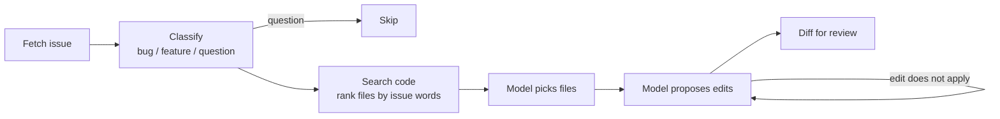

# GitHub Issue Coding Agent

An AI agent that reads a GitHub issue, finds the code involved and proposes a fix as a
reviewable diff. It runs entirely on your own machine for free: a local model, no API keys.

> **Status: week 1 of 3.** The agent suggests patches but never runs or pushes them.
> Week 2 adds a Docker sandbox that runs the tests, LangGraph, MCP tools and a human
> approval step before any draft PR. Week 3 adds the dashboard and benchmark results.

## How it works



Every step is saved to SQLite with its input, output and duration, so each run can be
inspected afterwards.

**Design choices**
- **Find-and-replace edits, not diffs.** Small models rarely get unified-diff line numbers
  right, but they can copy a few lines exactly. The agent applies the edits itself and
  produces the diff, so the diff is always valid. An edit that does not match exactly
  once is sent back to the model with the reason, up to 3 attempts.
- **Search before asking the model.** Files are ranked by how many words from the issue
  they contain (named functions count most). The model then picks from a short list
  instead of the whole repository. Test files are never candidates.
- **Model output is checked.** Ollama constrains each reply to a JSON schema, and the
  agent validates it with Pydantic. Paths the model returns must be on the candidate
  list, and no file outside the repository can be read.

## Stack

| Part | Choice |
|---|---|
| API | Python, FastAPI, Pydantic |
| Model | Ollama + `qwen2.5-coder:3b` (any Ollama model via one setting) |
| GitHub | GitHub REST API with `httpx`, Git |
| Storage | SQLite |
| Tests / CI | pytest, ruff, GitHub Actions |

## Demo repo

[`demo_repo/`](demo_repo) is a small shop library with 8 planted bugs. Each has an issue
in [`benchmark/issues.jsonl`](benchmark/issues.jsonl), written the way a user would
report it, and a hidden test in [`benchmark/hidden_tests/`](benchmark/hidden_tests) that
the agent never sees. A CI test checks that every hidden test fails on the current code.

## Run it

You need Python 3.11+ and [Ollama](https://ollama.com).

```bash
ollama pull qwen2.5-coder:3b
python -m venv .venv
.venv\Scripts\activate          # macOS/Linux: source .venv/bin/activate
pip install -r requirements-dev.txt

python -m agent.cli issues --demo
python -m agent.cli suggest --demo 8
```

A run takes a few minutes on a laptop CPU. It also works on public GitHub repositories:
`python -m agent.cli suggest owner/name 12`.

The API:

```bash
uvicorn agent.main:app --reload
```

`POST /api/runs` with `{"source": "demo", "issue_number": 8}` starts a run and returns at
once; `GET /api/runs/{id}` returns its status, diff and every step. Docs are at
http://localhost:8000/docs.

## Tests

```bash
pytest
```

The tests use a fake model and a fake GitHub, so they run offline in seconds.
