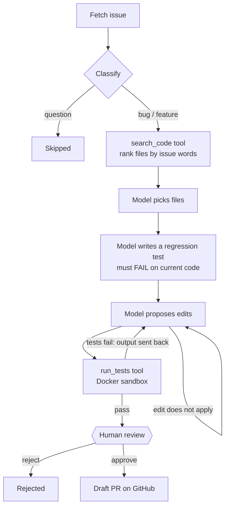

# GitHub Issue Coding Agent

An AI agent that reads a GitHub issue, writes a test that reproduces it, proposes a fix,
runs the tests in an isolated container and, once a person approves, opens a draft pull
request. It runs entirely on your own machine for free: a local model, no API keys.

> **Status: week 3 of 3, in progress.** The dashboard is done; a larger benchmark with
> measured results and a video walkthrough are next.

## How it works



The agent is a [LangGraph](https://github.com/langchain-ai/langgraph) state machine
([`agent/graph.py`](agent/graph.py)). Its state is saved to SQLite after every step, so a
run waiting for review survives a restart and resumes where it stopped. Every step is also
recorded with its input, output and duration, so each run can be inspected afterwards.

**Design choices**
- **A failing test first.** Before proposing a fix, the model writes a test from the
  examples in the issue, and the test must fail on the current code. That shows the bug
  was understood and gives the fix a concrete target. A test that already passes is sent
  back. If no test reproduces the bug, the repository's own tests still judge the fix.
- **Tests decide, not the model.** A patch is only offered for review after the
  repository's tests and the regression test pass. When they fail, the pytest output goes
  back to the model, up to 3 attempts. In week 1, without this, the model's patch for the
  median bug applied cleanly but was wrong; now the tests catch it.
- **Untrusted code runs only in a sandbox.** Tests run in a container with no network, a
  read-only filesystem, no Linux capabilities, an unprivileged user, and limits on
  memory, CPU, processes and time ([`agent/sandbox.py`](agent/sandbox.py)). Each run
  gets a fresh copy of the repository; the original is never modified.
- **A person approves every PR.** The graph pauses before anything is sent to GitHub.
  Approval opens a *draft* PR through the REST API, from the exact commit that was
  tested. The token is never given to git.
- **Tools over MCP.** The agent reads, searches and tests code only through an
  [MCP](https://modelcontextprotocol.io) server ([`agent/mcp_server.py`](agent/mcp_server.py)),
  bound to one repository. The same server works in any MCP client, such as Claude
  Desktop: `python -m agent.mcp_server --repo path/to/repo`.
- **Find-and-replace edits, not diffs.** Small models rarely get unified-diff line numbers
  right, but they can copy a few lines exactly. The agent applies the edits and produces
  the diff itself. An edit must match exactly once and the file must still compile.

## Stack

| Part | Choice |
|---|---|
| Agent | LangGraph (SQLite checkpoints, human-in-the-loop interrupt) |
| Tools | MCP server and client (official `mcp` Python SDK) |
| Model | Ollama + `qwen2.5-coder:3b` (any Ollama model via one setting) |
| Sandbox | Docker |
| API | Python, FastAPI, Pydantic |
| Dashboard | React, TypeScript, Vite |
| GitHub | GitHub REST API with `httpx`, Git |
| Storage | SQLite |
| Tests / CI | pytest, ruff, oxlint, GitHub Actions (sandbox tests run in CI too) |

## Demo repo

[`demo_repo/`](demo_repo) is a small shop library with 8 planted bugs. Each has an issue
in [`benchmark/issues.jsonl`](benchmark/issues.jsonl), written the way a user would
report it, and a hidden test in [`benchmark/hidden_tests/`](benchmark/hidden_tests) that
the agent never sees. A CI test checks that every hidden test fails on the current code.

## Run it

You need Python 3.11+, [Ollama](https://ollama.com) and
[Docker](https://www.docker.com/products/docker-desktop/).

```bash
ollama pull qwen2.5-coder:3b
docker build -t issue-agent-sandbox sandbox
python -m venv .venv
.venv\Scripts\activate          # macOS/Linux: source .venv/bin/activate
pip install -r requirements-dev.txt

python -m agent.cli issues --demo
python -m agent.cli run --demo 8        # stops at "awaiting_approval"
python -m agent.cli approve 1           # or: reject 1 --comment "why"
```

A run takes a few minutes on a laptop CPU. For the demo repo, approval saves the patch
to `data/patches/`. For a GitHub repository (`python -m agent.cli run owner/name 12`),
approval opens a draft PR. That needs `AGENT_GITHUB_TOKEN` (see
[`.env.example`](.env.example)): a fine-grained token for that one repository with
read/write access to contents and pull requests. Week 2 supports Python repositories
whose tests need only pytest, because the sandbox has no network to install packages.

### Dashboard

A React dashboard to start runs, watch each step as the agent works, read the diff,
regression test and sandbox output, and approve or reject. Build it once (needs
[Node.js](https://nodejs.org) 20+) and the API serves it:

```bash
cd dashboard && npm install && npm run build && cd ..
uvicorn agent.main:app
```

Then open http://localhost:8000. While working on the dashboard itself, run
`npm run dev` in `dashboard/` instead (http://localhost:5173, proxies `/api` to the API).

### API

```bash
uvicorn agent.main:app --reload
```

| Endpoint | |
|---|---|
| `POST /api/runs` | Start a run: `{"source": "demo", "issue_number": 8}`. Returns at once. |
| `GET /api/runs/{id}` | Status, diff, test output, regression test and every step |
| `POST /api/runs/{id}/approve` | Approve a run that is `awaiting_approval` |
| `POST /api/runs/{id}/reject` | Reject it, optionally with `{"comment": "..."}` |

Docs are at http://localhost:8000/docs.

## Tests

```bash
pytest
```

The tests use a fake model and a fake GitHub, so they need neither Ollama nor a network.
The graph tests really run pytest on a copy of the demo repo, so a wrong patch genuinely
fails. The Docker tests (network blocked, changes applied) are skipped when Docker is not
running, and always run in CI.
