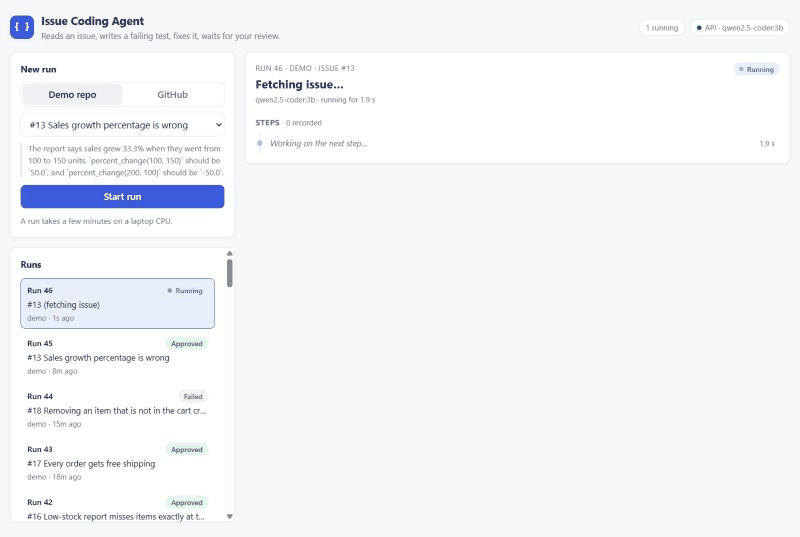
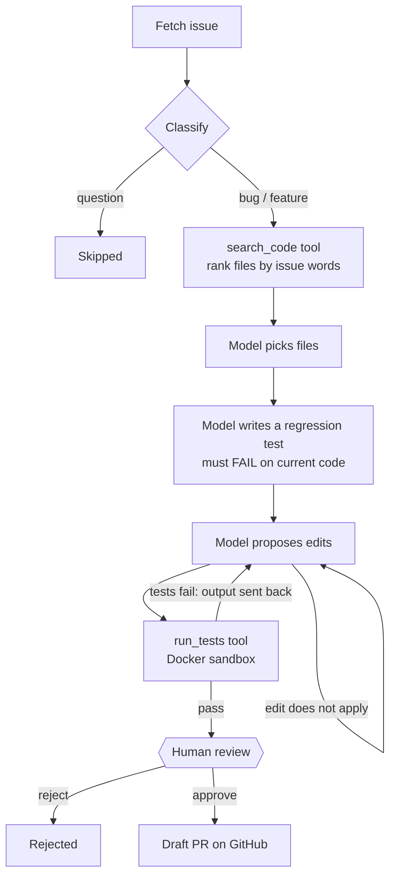
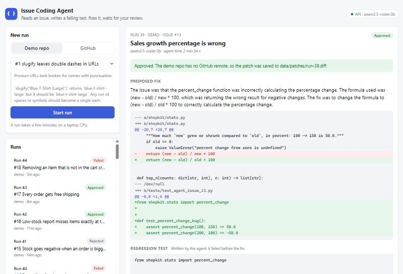
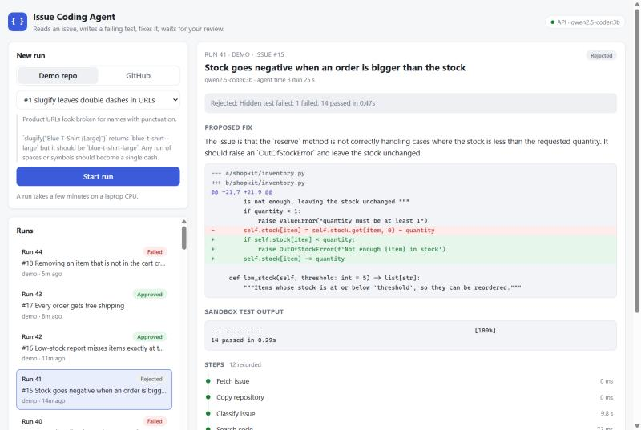

# GitHub Issue Coding Agent

An AI agent that reads a GitHub issue, writes a test that reproduces it, proposes a fix,
runs the tests in an isolated container and, once a person approves, opens a draft pull
request. It runs entirely on your own machine for free: a local model, no API keys.



**[Watch the 3-minute walkthrough video](docs/demo.mp4)** (narrated, with captions): a live
run from issue to approval, a wrong fix the hidden test caught, and the benchmark results.

**A real draft PR it opened:** given
[issue #1 in shopkit-demo](https://github.com/thousif-ai-portfolio/shopkit-demo/issues/1),
the agent wrote a failing test, fixed the code, passed the tests in the sandbox and, after
approval in the dashboard, opened
[draft PR #2](https://github.com/thousif-ai-portfolio/shopkit-demo/pull/2) by itself.

**Benchmark (18 planted bugs, graded by hidden tests):** a 3-billion-parameter model on a
laptop CPU fixes 6 of 18. When it asks for review, it is right 75% of the time, and every
patch is checked by a person before anything reaches GitHub. [Results and failure
analysis](#results).

## How it works



The agent is a [LangGraph](https://github.com/langchain-ai/langgraph) state machine
([`agent/graph.py`](agent/graph.py)). Its state is saved to SQLite after every step, so a
run waiting for review survives a restart and resumes where it stopped. Every step is also
recorded with its input, output and duration, so each run can be inspected afterwards.

**Design choices**
- **A failing test first.** Before proposing a fix, the model writes a test from the
  examples in the issue, and the test must fail on the current code. That shows the bug
  was understood and gives the fix a concrete target. A test that already passes is sent
  back, and so is a reply that isn't test code at all. If no test reproduces the bug, the
  repository's own tests still judge the fix.
- **Tests decide, not the model.** A patch is only offered for review after the
  repository's tests and the regression test pass. When they fail, the pytest output goes
  back to the model, up to 3 attempts. In week 1, without this, the model's patch for the
  median bug applied cleanly but was wrong; now the tests catch it.
- **Untrusted code runs only in a sandbox.** Tests run in a container with no network, a
  read-only filesystem, no Linux capabilities, an unprivileged user, and limits on
  memory, CPU, processes and time ([`agent/sandbox.py`](agent/sandbox.py)). Each run
  gets a fresh copy of the repository; the original is never modified.
- **A person approves every PR.** The graph pauses before anything is sent to GitHub.
  Approval opens a *draft* PR through the REST API, from the exact commit that was
  tested. The token is never given to git.
- **Tools over MCP.** The agent reads, searches and tests code only through an
  [MCP](https://modelcontextprotocol.io) server ([`agent/mcp_server.py`](agent/mcp_server.py)),
  bound to one repository. The same server works in any MCP client, such as Claude
  Desktop: `python -m agent.mcp_server --repo path/to/repo`.
- **Find-and-replace edits, not diffs.** Small models rarely get unified-diff line numbers
  right, but they can copy a few lines exactly. The agent applies the edits and produces
  the diff itself. An edit must match exactly once and the file must still compile.

**Trade-offs**
- **A 3B local model instead of a hosted one.** It is free, private and runs on a laptop
  with 8 GB of RAM, where a 7B model is too slow and tight on memory. The cost is
  quality: it fixes 6 of 18 benchmark bugs. Because the model is one setting, the same
  pipeline and benchmark can measure a stronger model without code changes.
- **LangGraph instead of a hand-written loop.** Checkpointing to SQLite and pausing for a
  person (`interrupt`) come built in, which is what lets a run wait for review and survive
  a restart. The cost is a framework dependency; the graph itself stays small
  ([`agent/graph.py`](agent/graph.py)).
- **A Docker sandbox instead of running tests directly.** Generated code is untrusted, so
  isolation is worth needing Docker and starting a container for every test run.
- **Draft PRs behind human approval instead of automatic merges.** Slower, but the
  benchmark shows why: some patches pass the agent's own tests and are still wrong.

## Stack

| Part | Choice |
|---|---|
| Agent | LangGraph (SQLite checkpoints, human-in-the-loop interrupt) |
| Tools | MCP server and client (official `mcp` Python SDK) |
| Model | Ollama + `qwen2.5-coder:3b` (any Ollama model via one setting) |
| Sandbox | Docker |
| API | Python, FastAPI, Pydantic |
| Dashboard | React, TypeScript, Vite |
| GitHub | GitHub REST API with `httpx`, Git |
| Storage | SQLite |
| Tests / CI | pytest, ruff, oxlint, GitHub Actions (sandbox tests run in CI too) |

## Demo repo and benchmark

[`demo_repo/`](demo_repo) is a small shop library (text, prices, cart, dates, statistics,
stock, shipping) with 18 planted bugs: off-by-one comparisons, wrong units, swapped
arguments, missing checks, lost remainders. Each has an issue in
[`benchmark/issues.jsonl`](benchmark/issues.jsonl), written the way a user would report
it, and a hidden test in [`benchmark/hidden_tests/`](benchmark/hidden_tests) that the
agent never sees. A CI test checks that every hidden test fails on the current code.

[`agent/benchmark.py`](agent/benchmark.py) runs the agent on every issue. When a run
reaches review, the benchmark checks its patch in the sandbox against the hidden test,
then approves or rejects it like a reviewer. A run counts as solved only if the hidden
test passes, not just the tests the agent wrote for itself.

```bash
python -m agent.benchmark              # all 18 issues, about 1 hour on a laptop CPU
python -m agent.benchmark --issues 1 8
```

Results are saved per model in [`benchmark/results/`](benchmark/results).

## Results

`qwen2.5-coder:3b` on a laptop (Intel i3, 8 GB RAM, no GPU), all 18 issues.
Full table: [`benchmark/results/qwen2.5-coder-3b.md`](benchmark/results/qwen2.5-coder-3b.md).

| Metric | Result |
|---|---|
| Solved (hidden test passes) | **6 / 18** (33%) |
| Offered for review (the agent's own tests passed) | 8 |
| Of those, actually correct | **75%** (6 of 8) |
| Wrote a regression test that failed before the fix | 12 / 18 |
| Solved on the first attempt / after a retry | 5 / 1 |
| Median agent time per issue | 3.4 min |

**Where it fails, honestly.** Of the 12 unsolved issues:
- **5: the edit didn't apply.** The model must copy the lines it replaces exactly, and a 3B
  model often gets the indentation or a character wrong three times in a row.
- **4: its fixes kept failing the tests.** Mostly the fixes were wrong. But in #6 the
  model's own test expected two different totals for the same cart, so nothing could pass
  it, and in #14 its test also demanded a `ValueError` the issue never asked for, which
  blocked a fix that the hidden test shows was correct.
- **2: wrong fix offered for review.** Both were issues where the model could not write a
  failing test, so only the repository's own tests judged the fix. A reviewer, or here the
  hidden test, rejects them. This is why a person approves every patch.
- **1: an infinite loop.** The sandbox's time limit stopped it after 120 seconds.

**What the benchmark caught in the agent itself.** The first full run scored 8 / 18 but
wrote **0** regression tests: the model was putting the test's file name where its code
should go, so every test crashed. With that fixed (a clearer prompt plus a check that
sends such replies back), the agent now writes a reproducing test for 12 of 18 issues, and
wrong fixes reaching review dropped from 6 to 2 (precision 57% to 75%). It solves fewer
issues outright (8 to 6), because its own test now blocks fixes it would have passed
before. For a tool whose output a person must trust, that is the better trade.

**Swap the model in one setting** (`AGENT_LLM_MODEL` in `.env`) and re-run the benchmark
to compare. A 7B model needs about 8 GB of free RAM.

## Screenshots

| A fix the reviewer approved | A plausible fix that the hidden test rejected |
|---|---|
|  |  |

## Limitations

- **Python repositories whose tests need only pytest.** The sandbox has no network, so it
  cannot install a project's dependencies.
- **Draft PRs need a GitHub repository.** The bundled demo repo has none, so there
  approval saves the patch instead; the unit tests cover the PR step with a fake GitHub
  API. It has been run live once, on
  [shopkit-demo](https://github.com/thousif-ai-portfolio/shopkit-demo/pull/2).
- **Public repositories only.** Cloning never asks for credentials, so a private
  repository fails at once with a clear error.
- **No login on the dashboard and API.** They are meant for your own machine
  (localhost); approving needs a JSON request, which other web pages cannot send.
- **Slow on a CPU:** about 3 minutes per issue with a 3B model.

## Run it

You need Python 3.11+, [Ollama](https://ollama.com) and
[Docker](https://www.docker.com/products/docker-desktop/).

```bash
ollama pull qwen2.5-coder:3b
docker build -t issue-agent-sandbox sandbox
python -m venv .venv
.venv\Scripts\activate          # macOS/Linux: source .venv/bin/activate
pip install -r requirements-dev.txt

python -m agent.cli issues --demo
python -m agent.cli run --demo 8        # stops at "awaiting_approval"
python -m agent.cli approve 1           # or: reject 1 --comment "why"
```

A run takes a few minutes on a laptop CPU. For the demo repo, approval saves the patch
to `data/patches/`. For a GitHub repository (`python -m agent.cli run owner/name 12`),
approval opens a draft PR. That needs `AGENT_GITHUB_TOKEN` (see
[`.env.example`](.env.example)): a fine-grained token for that one repository with
read/write access to contents and pull requests.

### Dashboard

A React dashboard to start runs, watch each step as the agent works, read the diff,
regression test and sandbox output, and approve or reject. Build it once (needs
[Node.js](https://nodejs.org) 20+) and the API serves it:

```bash
cd dashboard && npm install && npm run build && cd ..
uvicorn agent.main:app
```

Then open http://localhost:8000. While working on the dashboard itself, run
`npm run dev` in `dashboard/` instead (http://localhost:5173, proxies `/api` to the API).

### API

```bash
uvicorn agent.main:app --reload
```

| Endpoint | |
|---|---|
| `POST /api/runs` | Start a run: `{"source": "demo", "issue_number": 8}`. Returns at once. |
| `GET /api/runs/{id}` | Status, diff, test output, regression test and every step |
| `POST /api/runs/{id}/approve` | Approve a run that is `awaiting_approval` |
| `POST /api/runs/{id}/reject` | Reject it, optionally with `{"comment": "..."}` |

Docs are at http://localhost:8000/docs.

## Tests

```bash
pytest
```

The tests use a fake model and a fake GitHub, so they need neither Ollama nor a network.
The graph tests really run pytest on a copy of the demo repo, so a wrong patch genuinely
fails. The Docker tests (network blocked, changes applied) are skipped when Docker is not
running, and always run in CI.
